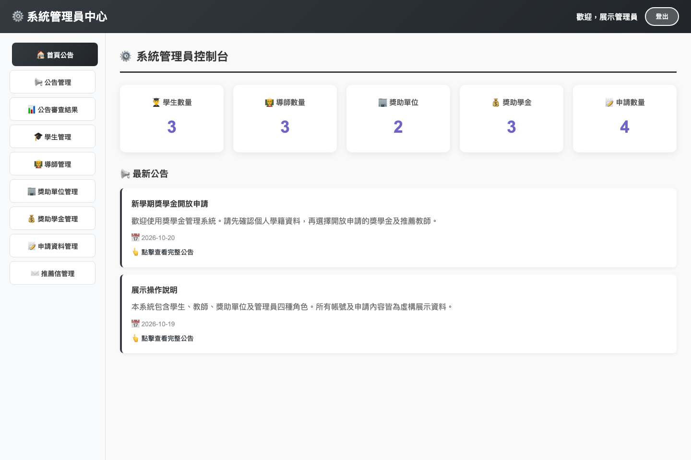
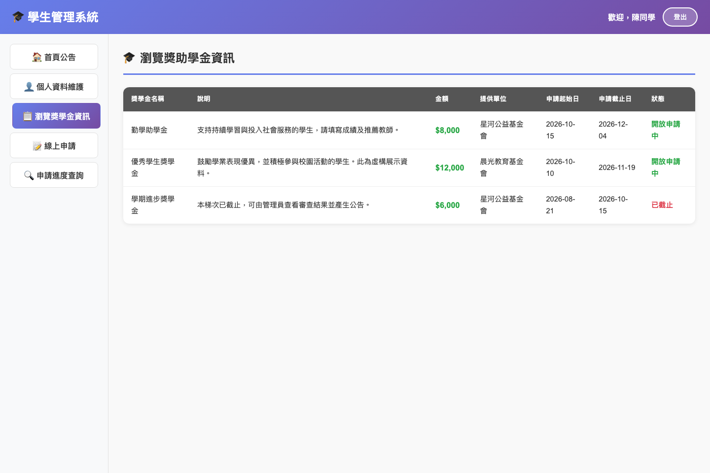
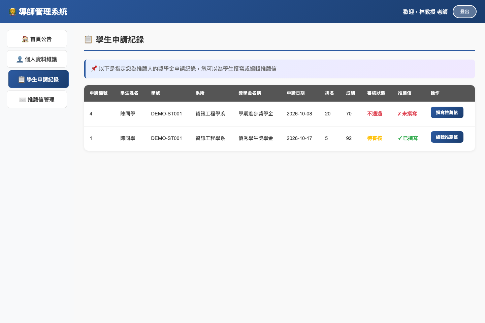
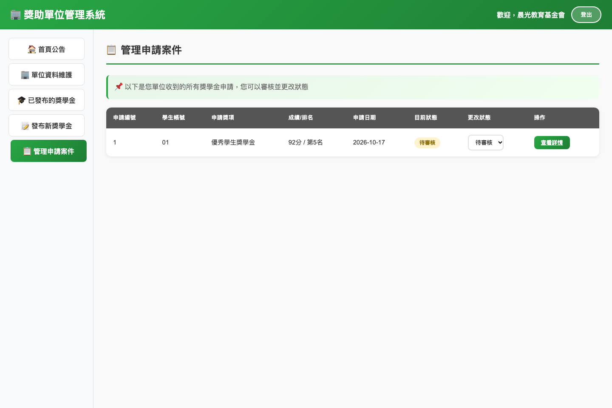
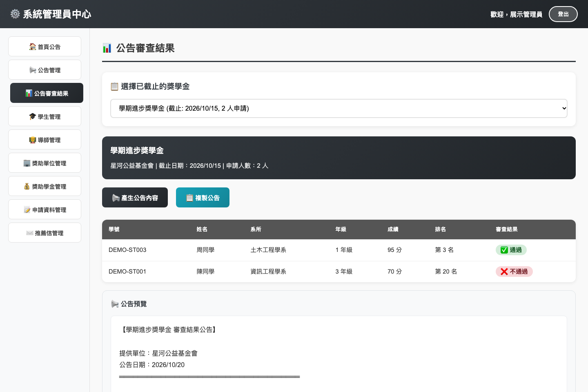

# 獎學金申請與管理系統

**Scholarship Management System** — 以 Node.js、Express 與 MySQL 實作的四角色獎學金申請平台，串起獎學金發布、學生申請、教師推薦、單位審核與結果公告。



這是一份由資料庫課程專案整理而成的作品展示版。保留原有繁體中文介面與多角色工作流程，補齊可重現的環境設定、資料完整性、後端登入權限及測試。版本選擇與來源說明見 [版本比對紀錄](docs/version-comparison.md)。

## 功能

| 角色     | 可操作的功能                                                                       |
| -------- | ---------------------------------------------------------------------------------- |
| 學生     | 維護學籍與個人資料、瀏覽獎學金、選擇推薦教師、線上申請、查詢審核進度               |
| 教師     | 查看學生指定的申請、撰寫及修改推薦信、維護個人資料                                 |
| 獎助單位 | 發布獎學金、查看發布清單與申請人數、審查自己單位的申請                             |
| 管理員   | 管理學生、教師、單位、獎學金、申請與推薦信；發布公告、產生截止獎學金的結果公告草稿 |

結果公告頁面提供預覽與複製；複製後可到「公告管理」貼上並發布。

## 快速啟動

需要 Docker 與 Docker Compose。先啟動 Docker Desktop 或 OrbStack，在專案根目錄執行：

```bash
cp .env.example .env
docker compose up -d --build --wait
```

開啟 **http://localhost:3000**。第一次建置需要下載映像與安裝相依套件。

資料庫使用 named volume 保存資料；一般停止與再次啟動會保留帳號與申請紀錄：

```bash
docker compose stop
docker compose up -d --wait
```

可選擇啟動 phpMyAdmin：

```bash
docker compose --profile tools up -d --wait
```

開啟 http://localhost:8888，以 `.env` 中的 `MYSQL_USER`、`MYSQL_PASSWORD` 登入。資料庫對本機開放於 `127.0.0.1:3307`；若連接埠被占用，修改 `.env` 的 `BACKEND_PORT`、`DB_EXTERNAL_PORT` 或 `PMA_PORT`。

## 展示帳號

所有帳號共用展示密碼 **`DemoPass123!`**；登入頁也有快速填入按鈕。帳號、姓名、Email、學號與基金會均為虛構資料，銀行欄位預設留空。

| 角色     | 帳號    | 預設展示內容                           |
| -------- | ------- | -------------------------------------- |
| 學生     | `01`    | 既有申請、審查結果，可申請另一筆助學金 |
| 教師     | `02`    | 已指定的學生申請與推薦信               |
| 獎助單位 | `03`    | 已發布的獎學金與待審案件               |
| 管理員   | `admin` | 管理儀表板、公告、名單與結果草稿       |

另有學生 `04`、`05`，教師 `06`、`08` 及單位 `07`，可測試不同帳號間的資料範圍。

建議展示順序：

1. 以學生 `01` 登入，確認個人資料，申請「勤學助學金」並指定教師 `02`。
2. 以教師 `02` 登入，在申請清單撰寫推薦信。
3. 以單位 `07` 登入，開啟申請案件、查看推薦信並更新審核狀態。
4. 以學生 `01` 查看進度；以管理員 `admin` 查看儀表板及已截止的「學期進步獎學金」結果草稿。

## 技術與設計

| 層級       | 實作                                                            |
| ---------- | --------------------------------------------------------------- |
| 前端       | HTML、CSS、原生 JavaScript，保留原專案 iframe 導覽              |
| 後端       | Node.js 22、Express 5、mysql2 連線池                            |
| 資料庫     | MySQL 8.4、InnoDB、外鍵、唯一鍵、檢查條件                       |
| 登入       | scrypt 密碼雜湊；資料庫保存 session token 的 SHA-256 雜湊       |
| 權限       | HttpOnly / SameSite Cookie，後端依角色與資料擁有者驗證          |
| 環境與驗證 | Docker Compose、Node.js test runner、Playwright、GitHub Actions |

學生帳號和學籍以 `user_id` 關聯；`student_id` 是內部主鍵，`student_number` 才是學號。獎學金的 `provider_id` 沿用原專案設計，指向獎助單位的 **使用者帳號**，不是單位的數字主鍵。資料表關聯與刪除行為見 [架構文件](docs/architecture.md)。

各角色的端點、欄位與權限見 [API 摘要](docs/api.md)。

## 畫面

| 學生：獎學金列表                          | 教師：指定申請與推薦信                    |
| ----------------------------------------- | ----------------------------------------- |
|  |  |

| 單位：申請審查                             | 管理員：結果公告草稿                      |
| ------------------------------------------ | ----------------------------------------- |
|  |  |

## 本機開發

需要 Node.js 22 以上。從專案根目錄啟動資料庫，再啟動後端；前端由同一個 Express 服務提供：

```bash
cp .env.example .env
docker compose up -d db --wait
cd backend
npm ci
npm run dev
```

如已啟動 Docker 版後端，請先在根目錄執行 `docker compose stop backend` 釋出 3000 埠。後端會讀取專案根目錄 `.env`；修改 `MYSQL_PASSWORD` 時，也要同步修改本機開發用的 `DB_PASSWORD`。

## 測試

在 `backend/` 執行：

```bash
npm ci
npm run check
npm test
npm audit --omit=dev
npm run test:integration
```

整合測試需要正在執行的 MySQL，預設從根目錄 `.env` 讀取本機連接埠及 root 測試密碼。測試會建立隨機命名的 `Scholarship_Test_*` 資料庫，完成後移除該資料庫。它不會清空展示資料庫。可用 `TEST_DB_HOST`、`TEST_DB_PORT`、`TEST_DB_USER`、`TEST_DB_PASSWORD` 指向具有建立測試資料庫權限的 MySQL 帳號。

瀏覽器測試需要先啟動整個應用程式，並保留初始展示帳號與資料：

```bash
npx playwright install chromium
npm run test:browser
```

瀏覽器測試會逐一檢查四種角色的導覽、學號顯示、結果預覽、含特殊字元的公告編輯、登出與手機登入畫面；截圖輸出到 `docs/screenshots/`。如使用不同服務埠，設定 `APP_URL`。測試會建立一筆公告並於檢查後刪除。

上傳 GitHub 後，工作流程會執行語法與連結檢查、單元測試、安全掃描及真實 MySQL 整合測試。瀏覽器測試可在本機另行執行。此整理版的本機驗證結果見 [驗證紀錄](docs/verification.md)。

## 專案結構

```text
.
├── backend/
│   ├── server.js          # 啟動、環境設定、正常關閉
│   ├── src/               # API、驗證、交易、登入與資料庫連線
│   └── test/              # 單元、MySQL 整合與瀏覽器測試
├── frontend/              # 31 個功能頁面與共用樣式、腳本
├── database/
│   ├── schema.sql         # 9 個資料表與完整性條件
│   └── seed.sql           # 虛構展示資料
├── docs/                  # 架構、API、版本、截圖與驗證紀錄
├── scripts/               # 程式檢查與乾淨 ZIP 打包
├── .github/workflows/     # CI
├── .env.example
└── compose.yaml
```

## 資料重設與展示範圍

SQL 初始化檔只會在資料庫 volume 為空時執行。展示日期以**第一次初始化當天**為基準：兩筆開放申請、一筆已截止。資料會隨時間自然過期，可以透過管理員修改日期。

需要完整重設時，以下指令會**刪除此 Compose 專案的資料庫 volume 及所有展示操作資料**，並重新匯入 schema 與 seed：

```bash
docker compose down --volumes
docker compose up -d --build --wait
```

本版本適合本機作品展示。教師和單位可以自行註冊，尚無校方審核、Email 驗證、忘記密碼或檔案上傳功能；推薦信以文字填寫。正式部署需另行設計 HTTPS、帳號審核、備份及營運管理，並更換展示資料與資料庫密碼。HTTPS 環境可將 `COOKIE_SECURE=true`，本機 HTTP 請保留 `false`。
