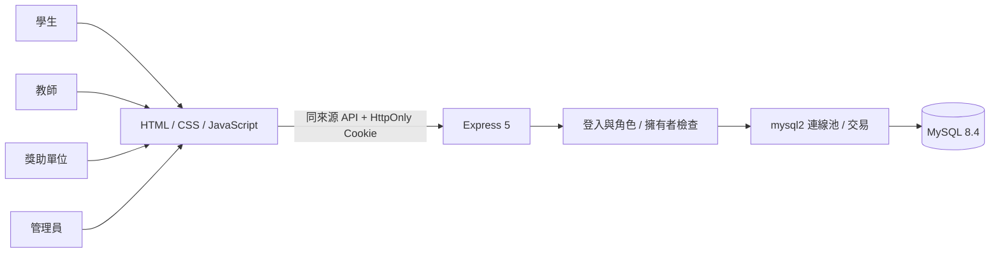
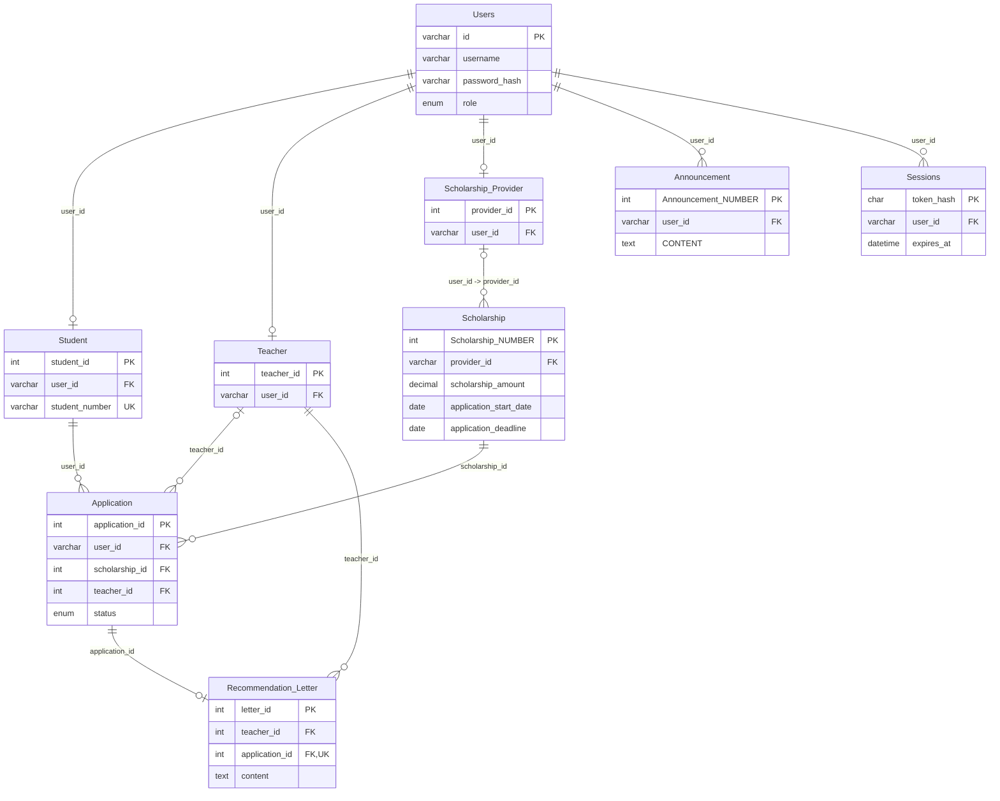

# 系統架構與資料庫

瀏覽器以同來源 `/api` 請求 Express，前端與 API 由同一服務提供。MySQL 保存業務資料與登入工作階段，Docker Compose 等資料庫健康後才啟動後端。

## 資料關聯

## 保留的欄位語意

- `Users.id`：登入帳號；`username` 是可重複的顯示名稱。登入必須使用帳號。
- `Student.student_id`：數字主鍵；`student_number`：使用者看見的學號。
- `Scholarship.provider_id`：沿用原設計的字串欄位，參照 `Scholarship_Provider.user_id`。
- `Application.teacher_id`：教師數字主鍵；前端由教師清單選取。
- `Sessions`：新增的登入資料表，僅存 token 的 SHA-256 雜湊。Cookie token 有效期 8 小時。

## 交易與完整性

註冊的帳號與角色資料使用同一筆交易，避免只有登入帳號卻沒有學籍的半成品。個人資料與管理員跨表編輯亦使用交易。

每位學生對同一筆獎學金只能有一份申請，每份申請只能有一封推薦信；由資料庫唯一鍵保證，包括同時送出的請求。申請時鎖定獎學金列、檢查資料庫當日是否落於申請期間（起訖日均包含），再新增申請。前端使用臺北日期判斷顯示狀態；資料庫日期仍是送出時的依據。

刪除學生會透過外鍵移除其申請與推薦信；刪除教師會移除其推薦信，並將申請教師設為 `NULL`。管理員刪除單位時，會在同一交易先刪除其獎學金及相關申請，再刪帳號。刪除獎學金、申請時，依外鍵逐層移除推薦信。公告作者刪除時保留公告並將作者設為 `NULL`。

管理員編輯與刪除角色時，帳號一律由該角色的主鍵查得；舊介面的 `?userId=` 參數不作為資料操作依據。

## 登入與前端

scrypt 以隨機 salt 雜湊密碼；登入建立隨機 256-bit token，Cookie 使用 `HttpOnly` 與 `SameSite=Strict`。API 每次都驗證 session、角色與資料歸屬；更改密碼會撤銷該帳號的所有 sessions。前端 localStorage 僅供顯示與導覽，不能授予 API 權限。登入每個來源 IP 在 15 分鐘內最多嘗試 30 次。

寫入 API 接受 JSON，並檢查瀏覽器送出的 Origin。前端共用 `html` 模板會轉義動態文字與 HTML 屬性；編輯物件由 `data-record` 解析，避免將物件直接嵌入行內 JavaScript。此版保留原有固定的行內事件處理，因此沒有宣稱使用禁止行內腳本的 CSP。

## 執行環境參考

Docker 映像採用 Node.js 22 及 MySQL 8.4，移除原有的 x86 平台強制設定。選擇與設定參考 [Node.js 發布週期](https://github.com/nodejs/Release) 與 [MySQL 官方 Docker 初始化程式](https://github.com/docker-library/mysql/blob/master/8.4/docker-entrypoint.sh)。MySQL 初始化腳本僅在全新資料目錄執行；持久資料不會因一般重建後端而重新匯入。
